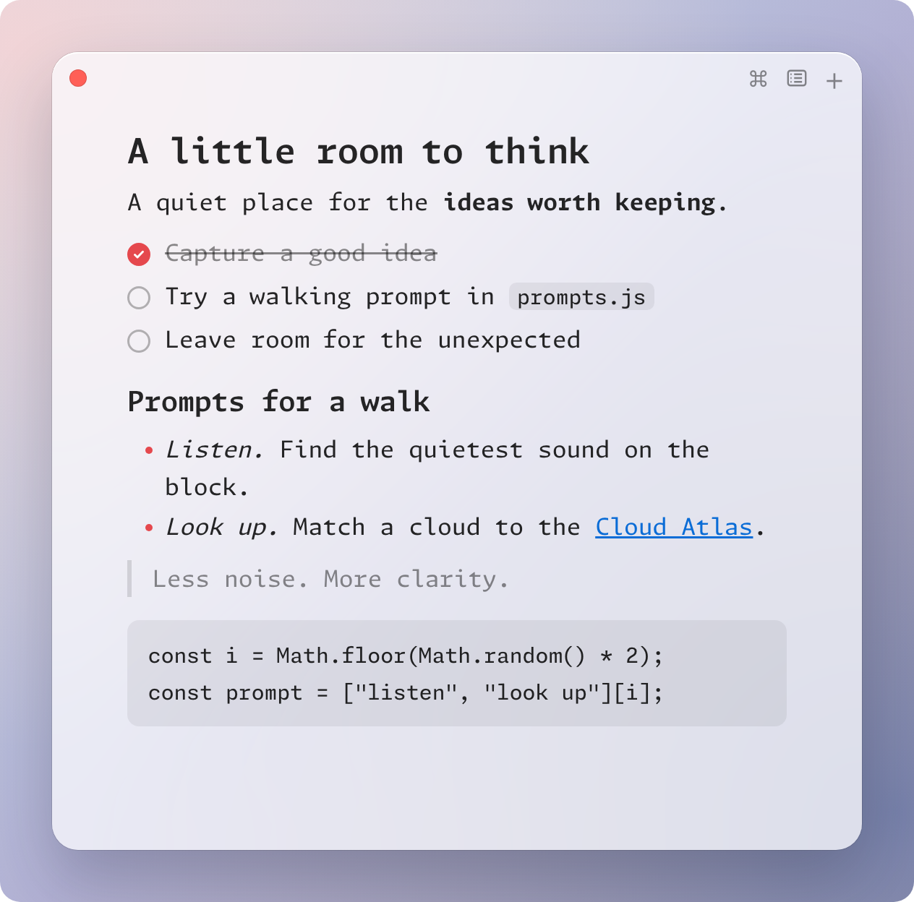
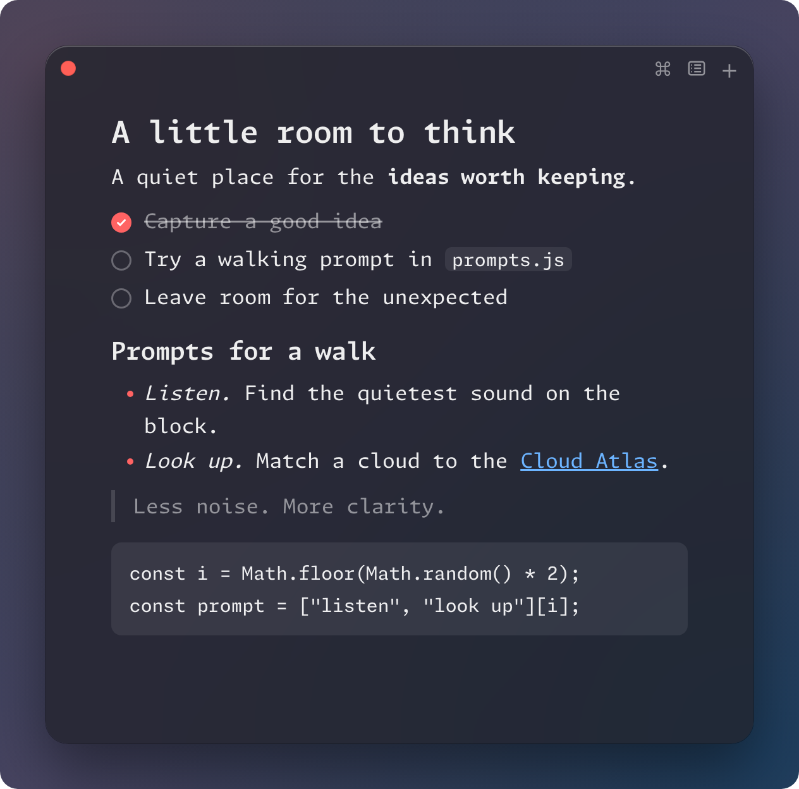

<p align="center"></p>

<h1 align="center">Jot</h1>

<p align="center"><strong>A little space for your thoughts.</strong><br>
A quiet, floating notepad that lives in your macOS menu bar.</p>

<p align="center">
  <a href="https://github.com/jmdelafe/jot/releases"><strong>Download Jot →</strong></a>
  &nbsp;·&nbsp; <a href="#get-started">Get started</a>
  &nbsp;·&nbsp; <a href="LICENSE">MIT licensed</a>
</p>

<p align="center"><sub>macOS 26+ · Apple Silicon · Early access</sub></p>

| Light preview | Dark preview |
| :---: | :---: |
|  |  |

## Catch the thought. Keep your flow.

Press **⌥⌘N**, jot it down, and get back to what you were doing.
Ideas, tiny checklists, meeting notes—without another app taking over your screen.

- **Always a shortcut away.** A floating window, no Dock icon, and a keyboard-first workflow.
- **More than plain text.** Markdown shortcuts, checklists, links, and a selection formatting toolbar.
- **Yours, on your Mac.** Automatic saving, offline use, and no account, sync, or telemetry.

Search your notes, pin the ones you reach for, and copy or export as Markdown,
HTML, or plain text when you're ready to take them elsewhere.

## Get started

1. Download `Jot-macos-arm64.zip` and `checksums.txt` from [Releases](https://github.com/jmdelafe/jot/releases).
2. Verify the download from the folder containing both files:

   ```sh
   shasum -a 256 -c checksums.txt
   ```

3. Unzip it, move `Jot.app` to `/Applications`, and open it. Press **⌥⌘N** to write your first note.

> [!WARNING]
> Downloads are **ad-hoc signed, not notarized or Developer ID signed**.
> If macOS blocks the first launch and you trust the download, open **System Settings →
> Privacy & Security → Open Anyway** after attempting to launch it.
> Do not disable Gatekeeper globally.

Before upgrading, quit Jot and [back up your notes](#data-privacy-and-recovery).
Only Apple Silicon downloads are provided; you can also build from source.

## Make yourself at home

**⌘N** starts a note. **⌘P** finds one. **⌘K** opens actions.
**Esc** gets Jot out of your way.

<details>
<summary><strong>All shortcuts and writing tips</strong></summary>

| Shortcut | Action |
| --- | --- |
| **⌥⌘N** | Show or hide Jot |
| **⌘N** | New note |
| **⌘P** | Browse and search notes |
| **⌘K** | Open actions |
| **⇧⌘P** | Pin or unpin the current or selected note |
| **⌃X** | Delete a note from the browser or actions |
| **⌘L** | Edit a link |
| **⌘-click** | Open a link |
| **Esc** | Close a palette or popover, or hide Jot |

You can also click the menu bar icon to show or hide Jot, ⌥-click for a new
note, or right-click for the menu. The floating window follows your macOS
appearance, grows with its content, and remembers its width. Hover over the
title bar for the Actions, Browse Notes, and New Note buttons.

**Write naturally.** Use Markdown shortcuts like `## `, `- `, `- [ ] `, and
`> `, or select text to show the formatting toolbar. Moving the cursor into
formatted text reveals editable Markdown; lists remain rendered as you edit.

**Copy and paste your way.** **⌘C** copies selected text as plain text;
**⇧⌘C** copies with formatting, or copies the whole note if nothing is
selected. **⌘V** pastes plain text in the surrounding style; **⇧⌘V** keeps
supported formatting. Paste a URL over selected text to create a link. Use
**⌘K** to copy or export as Markdown, HTML, or plain text.

**Keep notes organized.** Search includes note contents, and pinned notes
appear first. In the browser, **⇧⌘P** pins and **⌃X** deletes the selected
note. Deleted notes can be restored from *Recently Deleted* for 60 days.
Empty notes are reused or discarded when you leave them.

</details>

## Data, privacy, and recovery

Your notes stay local. No account, sync, or telemetry—and no encryption added
by Jot. Their protection depends on your macOS account and disk settings.

<details>
<summary><strong>Storage, backups, and recovering notes</strong></summary>

Notes stay on your Mac as JSON files in the sandbox container:

```text
~/Library/Containers/com.jmdelafe.jot/Data/Library/Application Support/Jot/Notes/
```

Links open in your default browser. Notes from the earlier single-note version
are imported automatically.

**Back up:** quit Jot and copy the entire `Jot` application-support folder,
including `Notes/index.json` and every note file. To restore, quit Jot, keep a
copy of the current folder, and replace it with a known-good backup. Exports
are portable copies, not complete backups of formatting and metadata.

**If saving fails:** Jot keeps pending edits in memory and offers **Retry**.
Check disk space and permissions, and keep Jot open or copy/export the current
note until saving succeeds. A normal quit is cancelled if edits cannot be
saved; a force-quit, crash, or power loss can still lose recent edits.

Unreadable data is copied to a uniquely named `.corrupt-…json` backup before
replacement. Keep those backups until recovery is complete. Recently Deleted
is not a backup: notes there are purged after 60 days.

The app is sandboxed. Its network client entitlement lets WebKit initialize;
the editor loads bundled content and works offline. The user-selected
read-write entitlement is used by the export save panel.

</details>

## Install from source

<details>
<summary><strong>Build and run Jot on your Mac</strong></summary>

You need macOS 26+, Swift 6.2+ (Command Line Tools or Xcode), and Node.js 24+
with npm.

```sh
git clone https://github.com/jmdelafe/jot.git
cd jot
make bootstrap
make run
```

`make bootstrap` installs the locked editor dependencies. `make run` builds
and launches the ad-hoc-signed `build/Jot.app`. To install it permanently,
quit Jot and copy the app to `/Applications`. Run only one copy at a time:
all copies share the same notes. To update, rebuild, quit the running copy,
and replace it.

After code changes, quit Jot and run `make run` again. `make build` builds the
debug app; it does not update or restart `build/Jot.app`.

</details>

## Development

> [!NOTE]
> Jot is being built with the help of AI coding agents.

See [CONTRIBUTING.md](CONTRIBUTING.md) for development, dependency updates,
reporting problems, and the release checklist.

<details>
<summary><strong>Build commands and releases</strong></summary>

| Command | Purpose |
| --- | --- |
| `make check` | Run tests and build the app |
| `make test` | Run editor, Swift, and release-script checks |
| `make test-editor` / `make test-swift` | Run one test suite |
| `make build` | Build the editor and debug app |
| `make bundle` | Build and verify `build/Jot.app` |
| `make dist` | Create the Apple Silicon ZIP and checksums |
| `make clean` | Remove build output and editor caches |

Swift tests use `JotTestRunner`, not `swift test`, to work around a
Command Line Tools test-driver issue. `make test-swift` uses the native build
backend and a separate `.build/testing` cache. If `tsc` or `vite` is missing,
run `make bootstrap`.

### Releases

Versions follow [Semantic Versioning](https://semver.org). The numeric version
in `Packaging/Info.plist` must match the release tag; pre-release suffixes
such as `-alpha.1` appear only in the tag. After merging the version to
`master`, run from a clean, up-to-date `master` checkout:

```sh
make release VERSION=0.1.0-alpha.1
```

This validates and pushes the tag. GitHub Actions runs CI and publishes the
app ZIP, checksums, and source archives. See the [release checklist](CONTRIBUTING.md#alpha-release-checklist) before releasing.

</details>

## License

Jot is available under the [MIT license](LICENSE). Third-party dependencies
retain their own licenses.
